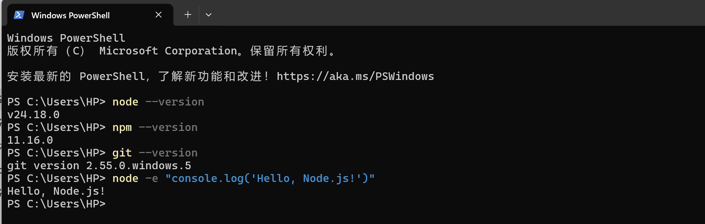
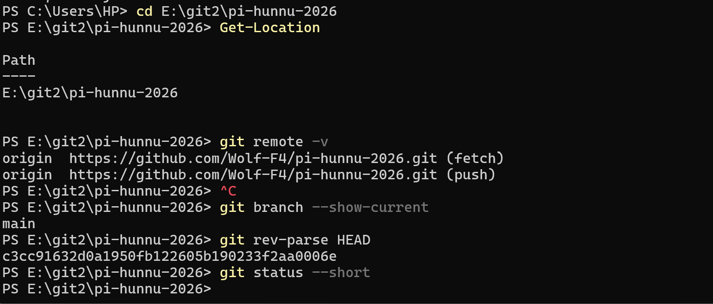
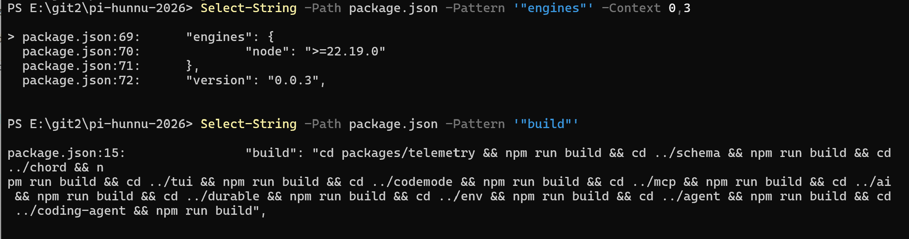
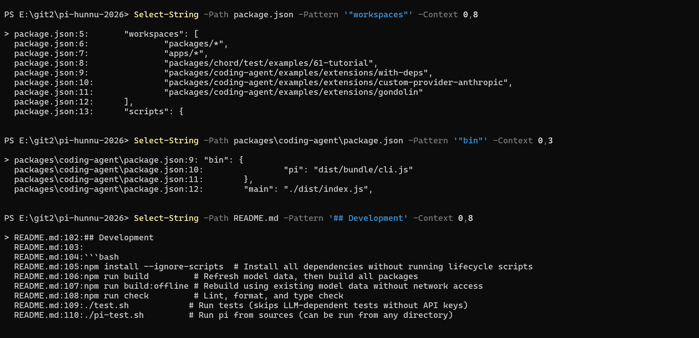
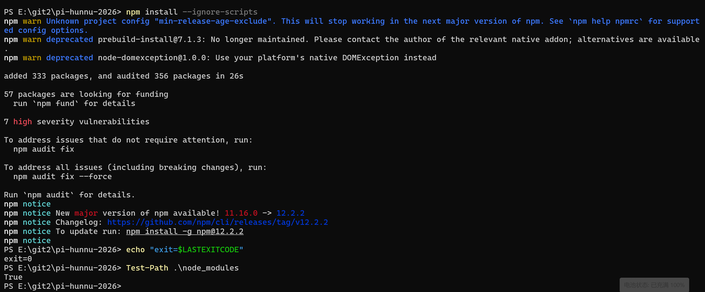
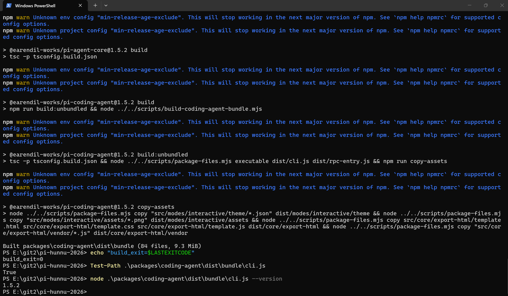
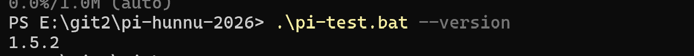
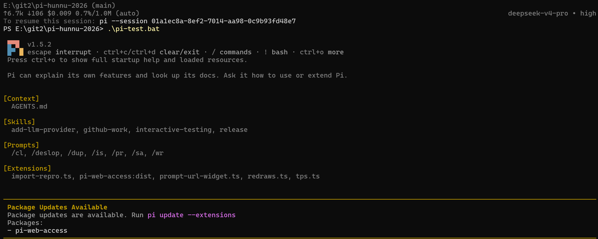
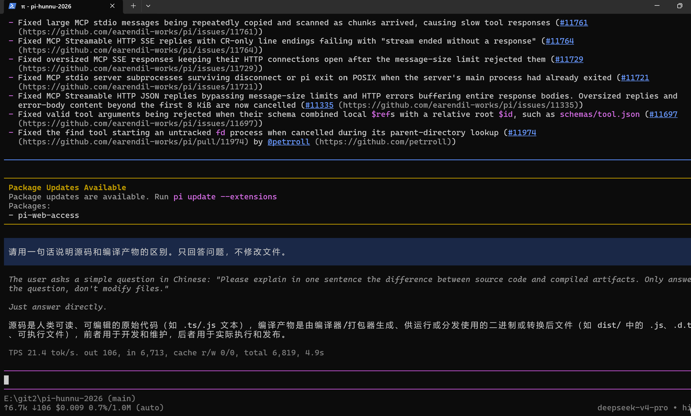

# 实践课3：Pi Agent 源码获取、依赖安装与本地编译报告

- **姓名 / 学号**：曹紫欣 202430224047
- **小组仓库地址**：`https://github.com/Wolf-F4/pi-hunnu-2026`
- **本地源码路径**：`E:\git2\pi-hunnu-2026`
- **当前分支与提交编号（HEAD）**：`main` / `c3cc91632d0a1950fb122605b190233f2aa0006e`

---

## 一、实验准备：检查开发工具（截图 S1）

在 PowerShell 中依次检查本地 Node.js、npm 与 Git 版本：

```powershell
node --version   # v24.18.0
npm --version    # 11.16.0
git --version    # git version 2.55.0.windows.5
```

| 检查工具 | 本次实验用途 | 仓库/课程要求 | 本机实测版本 | 是否满足 |
|---|---|---|---|---|
| **Node.js** | 运行 JS 程序与项目开发/构建脚本 | 根 `package.json` 声明 `>=22.19.0`，课程建议使用 Node.js 24 LTS | `v24.18.0` | 满足（无需重装或切换） |
| **npm** | 安装工作区依赖、执行项目构建脚本 | 随 Node.js 自动安装，根配置未锁定固定版本 | `11.16.0` | 满足 |
| **Git for Windows** | 克隆、核验与管理仓库源码 | 安装后可正常执行 `git --version` | `git version 2.55.0.windows.5` | 满足 |
| **编辑器** | 阅读配置文件与源码 | VS Code / 文本编辑器 | VS Code | 满足 |



---

## 二、确认本地源码来源与版本（截图 S2）

进入第二次实践课克隆好的小组仓库目录 `E:\git2\pi-hunnu-2026`（全英文、无空格路径），核对本地路径、远端仓库、当前分支、完整提交编号及工作区状态：

```powershell
cd E:\git2\pi-hunnu-2026
Get-Location
git remote -v
git branch --show-current
git rev-parse HEAD
git status --short
```

| 核验项 | 实际输出结果 | 核验结论 |
|---|---|---|
| 当前目录 (`Get-Location`) | `E:\git2\pi-hunnu-2026` | 位于全英文路径的仓库根目录 |
| 远端仓库 (`git remote -v`) | `https://github.com/Wolf-F4/pi-hunnu-2026.git` | `origin` 正确指向小组组织仓库 |
| 当前分支 (`git branch --show-current`) | `main` | 处于主分支 `main` |
| 完整提交编号 (`git rev-parse HEAD`) | `c3cc91632d0a1950fb122605b190233f2aa0006e` | 已记录完整 40 位哈希 |
| 工作区状态 (`git status --short`) | 无输出 | 工作区干净，无未提交改动 |



---

## 三、阅读项目配置，确认安装与编译依据（截图 S3）

在根目录查看 `README.md`、`package.json`、`package-lock.json`、`packages/` 以及 `packages/coding-agent/package.json`：

| 文件或目录 | 观察到的核心内容 | 作用与结论 |
|---|---|---|
| `README.md` | `## Development` 章节列出 `npm install --ignore-scripts`、`npm run build`、`npm run build:offline`、`npm run check`、`./test.sh`、`./pi-test.sh` | 明确项目的官方安装、构建、检查与本地运行命令规范 |
| `package.json`（根） | `engines.node: ">=22.19.0"`；`workspaces` 包含 `packages/*`、`apps/*` 等；`scripts.build` 用 `&&` 串联 11 个子包构建；`devDependencies` 含 `typescript`、`esbuild`、`@biomejs/biome` 等 | 确定 Node.js 版本门槛、monorepo 多包管理边界以及全局编译工具链与构建顺序 |
| `package-lock.json` | 根目录统一的依赖锁定文件（约 206 KB） | 精确锁定全部直接与传递依赖版本，应统一在根目录安装，不能进子包单独生成锁文件 |
| `packages/` | 包含 `telemetry`、`schema`、`chord`、`tui`、`codemode`、`mcp`、`ai`、`durable`、`env`、`agent`、`coding-agent`（以及未进构建链的 `evals`） | 构成 Pi Agent 的分层模块化源码集合 |
| `packages/coding-agent/package.json` | `"bin": { "pi": "dist/bundle/cli.js" }`；`scripts.build` 执行 `build:unbundled` 与 `build-coding-agent-bundle.mjs` | 说明命令行入口 `pi` 最终指向打包后的 `dist/bundle/cli.js` |





### 问题回答
1. **Node.js 版本要求在哪里？**
   - 定义在仓库根目录 `package.json` 的 `"engines": { "node": ">=22.19.0" }` 字段中（第 69~71 行）；同时部分工作区或传递依赖包可能会声明更高的引擎版本，因此本实验建议使用 Node.js 24 LTS。
2. **`npm run build` 实际从哪里读取命令？**
   - `npm run build` 读取当前目录 `package.json` 中 `"scripts"` 下的 `"build"` 字段（第 15 行）。
   - 根 `package.json` 的 `build` 命令通过 `&&` 串联，按依赖顺序依次进入 `packages/telemetry`、`schema`、`chord`、`tui`、`codemode`、`mcp`、`ai`、`durable`、`env`、`agent`、`coding-agent` 子目录，执行各子包自己的 `npm run build`；只有上一步退出码为 0 时才会继续构建下一个包。

---

## 四、在仓库根目录安装依赖（截图 S4）

在包含根 `package.json` 的 `E:\git2\pi-hunnu-2026` 根目录执行：

```powershell
npm install --ignore-scripts
echo "exit=$LASTEXITCODE"
Test-Path .\node_modules
```

### 命令作用说明
1. 根据根目录 `package.json` 和 `package-lock.json` 解析并下载锁定版本的依赖到本地 `node_modules`，同时建立 npm workspaces 对 `packages/*` 子包的本地关联；
2. 安装编译器（如 `typescript`）、打包器（如 `esbuild`）及运行库；
3. 命令中**没有 `-g`**，只安装当前项目依赖，不会替换第一次实践课安装的全局 `pi` 命令；
4. **`--ignore-scripts`** 跳过安装阶段自动触发的生命周期脚本（如 `postinstall`、`prepare`），防止第三方依赖在安装时自动执行脚本，且不影响后续主动执行 `npm run build`。

### 安装输出与警告区分表

| 输出项 | 实际日志内容 | 性质判定 | 处理方式与原因 |
|---|---|---|---|
| `EBADENGINE` | 未出现 | — | 本机为 Node.js `v24.18.0`，完全满足项目及依赖要求 |
| 配置警告 | `npm warn Unknown project config "min-release-age-exclude"` | 非致命警告 | `.npmrc` 中面向较新包管理器的配置项提示，不影响依赖安装 |
| 弃用警告 | `deprecated prebuild-install@7.1.3`、`node-domexception@1.0.0` | 非致命警告 | 传递依赖上游停止维护提示，不等同于安装失败 |
| 安全审计 | `7 high severity vulnerabilities` | 审计提醒 | **不执行 `npm audit fix --force`**，避免擅自升级依赖破坏锁定的课程版本 |
| 汇总与退出码 | `added 333 packages, and audited 356 packages in 26s`；`exit=0`；`Test-Path .\node_modules` 为 `True` | **安装成功** | 退出码为 `0` 且 `node_modules` 已正确生成 |



---

## 五、本地编译与构建产物验证（截图 S5）

在根目录依次执行首次完整编译及构建产物检查：

```powershell
npm run build
echo "build_exit=$LASTEXITCODE"
Test-Path .\packages\coding-agent\dist\bundle\cli.js
node .\packages\coding-agent\dist\bundle\cli.js --version
```

### 构建结果与机制说明
- **构建产物验证**：最终生成 `packages\coding-agent\dist\bundle`（84 files, 9.3 MiB），退出码 `build_exit=0`；`Test-Path .\packages\coding-agent\dist\bundle\cli.js` 输出 `True`；运行 `node .\packages\coding-agent\dist\bundle\cli.js --version` 输出版本号 **`1.5.2`**。
- **关于“模型数据”与源码修改原则**：
  - 首次 `npm run build` 时 `packages/ai` 会联网拉取模型目录与能力配置数据（**不是下载大模型权重**）；
  - `dist/` 目录保存编译和打包生成的产物，后续修改程序功能时**应修改 `src/` 下的源码再重新构建**；如果直接修改 `dist/` 中的文件，下次构建时会被覆盖。

| 构建命令 | 执行内容 | 适用场景 |
|---|---|---|
| `npm run build` | 联网刷新 `packages/ai` 的模型目录配置数据，随后按顺序编译全部 11 个子包并打包 | **首次完整构建**，或需要更新模型目录数据时 |
| `npm run build:offline` | 跳过联网刷新，校验并复用本地已有模型目录数据，重新编译全部子包并打包 | **后续仅修改源码后的离线重新编译**（若数据缺失/过期需恢复网络跑 `npm run build`） |



---

## 六、启动本地源码版本并完成一次会话（截图 S6）

在根目录通过源码入口脚本验证版本并启动本地 Pi：

```powershell
.\pi-test.bat --version
.\pi-test.bat
```

进入交互界面后，输入测试提示词：
> `请用一句话说明源码和编译产物的区别。只回答问题，不修改文件。`

成功收到模型（`deepseek-v4-pro`）的回答：
> 源码是人类可读、可编辑的原始代码（如 `.ts`/`.js` 文本），编译产物是由编译器/打包器生成、供运行或分发使用的二进制或转换后文件（如 `dist/` 中的 `.js`、`.d.ts`、可执行文件），前者用于开发和维护，后者用于实际执行和发布。







### 启动方式对比与问题回答

| 启动命令 | 实际运行位置/入口 | 是否需要重新 `build` | 适用场景 |
|---|---|---|---|
| `pi`（全局命令） | 第一次实践课全局安装的 npm 包 | 不反映本地源码修改 | 仅作为日常已安装客户端使用；本次实验不能用它代替本地源码验证 |
| `.\pi-test.bat` | 通过 `pi-test.ps1` 加载 `source-resolver.ts`，直接执行 `packages/coding-agent/src/cli.ts` | **不需要**（直接运行 `src/`） | **本地源码开发与调试**：修改源码后可立即运行验证 |
| `node .\packages\coding-agent\dist\bundle\cli.js` | `packages/coding-agent/package.json` 的 `bin.pi` 指向的最终打包产物 | **需要**（修改源码后须重新编译） | **验证构建产物与发布态运行**：检验打包产物是否完整、脱离源码解析器独立运行 |

1. **本次如何确保运行的是本地源码？**
   - 没有直接输入全局 `pi`，而是在 `E:\git2\pi-hunnu-2026` 根目录执行 `.\pi-test.bat`（内部调用 `pi-test.ps1` 并通过 `node --import` 加载 `source-resolver.ts` 直接运行 `src/cli.ts`）。从启动横幅加载当前仓库 `AGENTS.md`、本地 `[Skills]`、`[Prompts]` 与 `[Extensions]` 也能确认为本地源码。
   - 本次复用 `~/.pi/agent` 中的已有用户凭据（无需再次 `/login`），这只表示共享用户配置目录，不代表运行的是全局安装包。
2. **源码入口与 `dist/bundle/cli.js` 入口分别适合什么场景？**
   - 如上表所示：`.\pi-test.bat` 适合**开发调试阶段快速验证 `src/` 改动**；`node .\packages\coding-agent\dist\bundle\cli.js` 适合**验证最终编译打包产物是否可用及对外分发运行**。

---

## 七、遇到的问题及解决过程（重点）

| 序号 | 遇到的问题 / 现象 | 原因分析 | 解决与验证方法 |
|---|---|---|---|
| **1** | 执行 `npm install --ignore-scripts` 和 `npm run build` 时反复出现 `Unknown config "min-release-age-exclude"`、`deprecated` 及 `7 high severity vulnerabilities` 警告 | `.npmrc` 中包含面向较新包管理器的配置键；部分传递依赖存在弃用与审计提示，但均非阻断错误 | 通过 `echo "exit=$LASTEXITCODE"`（`0`）与 `Test-Path .\node_modules`（`True`）确认安装成功；坚持不跑 `npm audit fix --force`，继续编译后 `build_exit=0` |
| **2** | 执行 `git remote -v` 后误触发 `^C` 中断；且任务三需同时核对 3 个文件多处配置，编辑器翻页不便对照 | 终端误触中断；多文件分散字段不易同屏核验 | 原目录补齐运行 `git branch`、`git rev-parse HEAD`、`git status` 确认状态；改用 PowerShell `Select-String -Path ... -Pattern ... -Context` 精准提取各配置文件段落并留存 `S3`、`S3-2` |
| **3** | 首次进入 Pi 界面复用了 `~/.pi/agent` 的 `deepseek-v4-pro` 登录配置并提示扩展更新，仅看对话截图无法直接体现是通过本地源码启动的 | 对话界面本身默认不显示外层 PowerShell 启动命令行 | 退出对话后在终端补充执行 `.\pi-test.bat --version`（`1.5.2`）和 `.\pi-test.bat` 截取命令行与加载仓库 `AGENTS.md` 的初始化横幅（`S6-1`、`S6-2`），并检查未泄露密钥与回调地址 |


---

## 八、实验总结（回答四个核心问题）

| 核心问题 | 本次实验核实结论 |
|---|---|
| **源码在哪里？** | 位于本地纯英文路径 `E:\git2\pi-hunnu-2026`（来自小组组织仓库 `https://github.com/Wolf-F4/pi-hunnu-2026.git` 的 `main` 分支，提交编号 `c3cc91632d0a1950fb122605b190233f2aa0006e`），核心源码分布在 `packages/*/src/` |
| **依赖装在哪里？** | 通过根目录 `npm install --ignore-scripts` 安装在仓库根目录 `E:\git2\pi-hunnu-2026\node_modules` 中（由根 `package-lock.json` 锁定版本并通过 workspaces 关联子包），未安装为全局包 |
| **构建执行了什么？** | 执行根 `package.json` 的 `scripts.build`，按拓扑顺序串行进入 11 个子包运行 TypeScript 编译；其中 `ai` 拉取模型目录配置数据，`coding-agent` 最终通过 `esbuild` 打包输出到 `packages\coding-agent\dist\bundle\cli.js` |
| **正在运行哪个版本？** | 运行的是本地源码仓库对应的 **`v1.5.2`**（通过 `.\pi-test.bat` 直接运行 `packages/coding-agent/src/cli.ts`，以及通过 `node .\packages\coding-agent\dist\bundle\cli.js` 运行编译产物均输出 `1.5.2`） |
